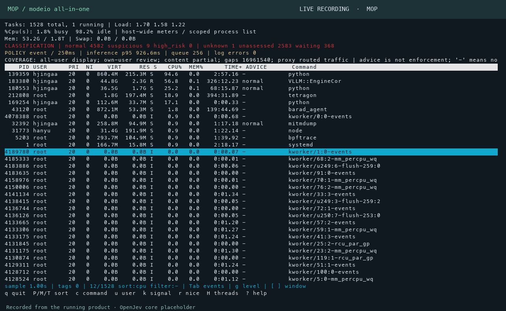

https://github.com/user-attachments/assets/1375e751-ebdf-40ff-bdaa-c1cdbcc4b606

<p align="center">English · 2:30 · MOP product vision</p>

**MOP — top, for the age of AI agents.**

MOP is modeio's all-in-one product for seeing what AI agents do on a computer.
It brings the familiarity of **top**, **htop** and **btop** together with AI security
review: inspect processes, follow their activity, and open the evidence behind a decision.

The film introduces the three terminal views, the guard model slot, and the
vLLM-Jev engine behind them—with specialized guards for privacy, permissions,
content and compliance in the product roadmap.

<p align="center">
  <a href="#install">Install</a> · <a href="#use-it-like-top">Usage</a> · <a href="#see-it-in-action">Live demos</a> · <a href="#models">Models</a> · <a href="docs/README.md">Docs</a>
</p>

## Install

**Homebrew on Linux**

```bash
brew install mode-io/tap/mop
```

**Debian / Ubuntu** — add the signed repository and install:

```bash
curl -fsSL https://github.com/mode-io/mop/releases/download/apt/setup-apt.sh | sudo bash
```

After that, use `sudo apt install mop` and `sudo apt upgrade` as usual.
Run **`mop`**, **`hmop`** or **`bmop`** from any directory.
No GitHub account is required.

[RPM, Arch, portable Linux, uv and pipx →](docs/packages.md)

For AI review, [start the local OpenJev service](docs/jev-2b-batching.md).
For background output and API-body collection, [enable full capture](docs/system-install.md#full-capture).

## Use it like top

| Command | Familiar style | Best for |
| --- | --- | --- |
| `mop` | top | A compact process list |
| `hmop` | htop | Meters, process trees and inspection |
| `bmop` | btop | Resource graphs and a security dashboard |

**P** CPU sort · **M** memory sort · **↑ ↓** select · **Enter** inspect · **m** models · **?** help · **q** quit

```bash
mop                          # watch your system
mop -p 12345                 # focus on one process
mop run -- python app.py      # review a command and its output
```

For API requests, after enabling full capture:

```bash
mop-network exec -- python app.py
```

To keep reviewing after you close the terminal:

```bash
mop daemon start
```

All three views connect to the same background observer.

## See it in action



Recorded from a running Linux host. The clips show live process views,
CPU/memory sorting, row selection and navigation through the model catalog.

| View | Recording |
| --- | --- |
| MOP | [Watch video](docs/demos/mop.mp4) |
| H-MOP | [Watch video](docs/demos/hmop.mp4) |
| B-MOP | [Watch video](docs/demos/bmop.mp4) |
| Models | [Watch video](docs/demos/models.mp4) |

## How it works

**Observe → Review → Inspect**

MOP collects system activity and captured content, groups related evidence,
and splits long inputs into small review units. A shared guard policy classifies
them as **normal**, **suspicious** or **high_risk**. Open a finding to inspect
its evidence. `unknown` means no usable judgment was returned.

Reviews run in the background through vLLM-Jev. You can sort, inspect and manage
processes from the same terminal. [Customize categories and the shared prompt →](docs/classification.md)

## Models

OpenJev powers the current core slot while we build the MOP model family.
Press **m**, or run `mop models`, to explore the catalog.

| Model | Focus | Status |
| --- | --- | --- |
| **jev-core** | General activity review | OpenJev placeholder available; dedicated model coming soon |
| **guard-privacy** | Personal data and secret exposure | Coming soon |
| **guard-permission** | Permissions and authorization | Coming soon |
| **guard-content** | Harmful content and scams | Coming soon |
| **guard-compliance** | Policy and compliance review | Coming soon |

[Model slots and custom rules →](docs/model-slots.md)

---

[Installation](docs/system-install.md) · [Controls](docs/ui.md) ·
[Capture coverage](docs/network-coverage.md) · [Architecture](docs/architecture.md) ·
[Performance](docs/latency-optimization.md)

Built by **modeio**. Inspired by [top](https://man7.org/linux/man-pages/man1/top.1.html),
[htop](https://github.com/htop-dev/htop) and [btop](https://github.com/aristocratos/btop).
