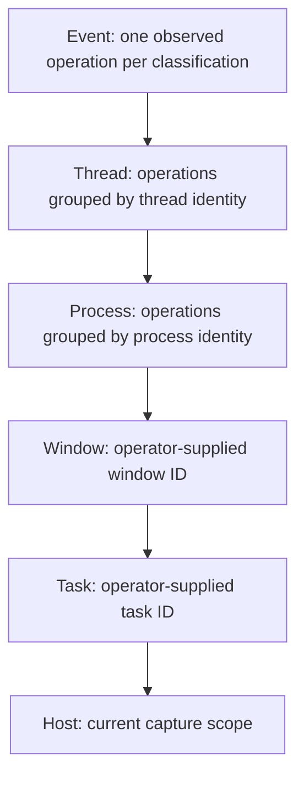

# Assessment granularity

Granularity changes the unit sent to the classifier, not kernel capture coverage.
Use `g` to cycle available levels and `[ / ]` to change the aggregation window.



Event is the default and retains independent classifications. Coarser levels
provide counts and bounded samples per group, not a verdict on every constituent
operation. The UI labels these results `group`. Runtime evidence enrichment
currently applies to individual process events, not aggregate summaries.

```bash
hmop --level thread --window-ms 250
mop replay --level window --context /absolute/window-context.json /absolute/events.jsonl
```

Window/task levels require explicit context IDs. Desktop window discovery is not
implemented. Missing process identities fall back to finer units and are counted.
Switching level or window flushes pending groups. `--max-events` and `--max-groups`
bound aggregation storage. Check/assess/review are single-unit boundaries and
require event level. Proposed-operation descriptions bypass asynchronous aggregation.

Microbatching is independent: it sends several separate assessment units in one
HTTP request while preserving a separate state and category for each one.
