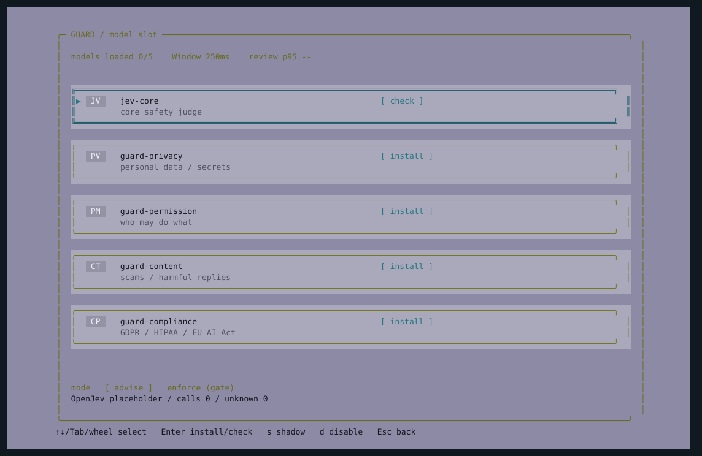

# Models, rules and a shared observer

MOP uses OpenJev as its core model. Replace the hosted endpoint or add specialist
slots as your models become available. Every terminal reads the same model registry.

## Keep review running

```bash
mop daemon start
mop
```

Open `hmop` or `bmop` to use another view of the same observer. Closing a view leaves
the daemon running. Use `mop daemon status` to inspect it and `mop daemon stop` to
stop it. A standalone session is available with `mop --standalone`.

The daemon runs as your user and uses a private Unix socket. This release starts it
for the current boot; it does not install a boot-time service.

## Open the model panel

Press **m** in any view to open the film-inspired Models page: five horizontal
cards on a lavender background, with colored initials, descriptions and model status.
The core card is named `jev-core`; it uses your configured core model, currently OpenJev.

- **Up/Down**, **Tab**, or the mouse wheel selects a card; **Home/End** jumps to either end; **Enter** installs a placeholder or checks an existing connection.
- **s** switches a specialist between active and shadow; **d** enables or disables it.
- **:** opens model and rule commands; **Esc** returns to processes.

The four guard cards start uninstalled. Install verifies the existing core endpoint
and registers a shadow slot using the same model. They remain labeled as placeholders
until you replace their manifests with your specialist models. Checking runs in the
background; the panel shows measured latency, without simulated download percentages.

The mode row keeps host monitoring in **advise**. Press **e** for the explicit
`mop gate --mode enforce` command. It does not toggle host-wide enforcement.



```bash
mop models
mop models probe openjev-core
```

`configured` means registered; `reviewing` means a call has completed. Inspect
unknown counts and verdict details for errors. GPU memory is not attributed to a
slot when several slots share a serving process.

## Connect another model

Register a manifest describing an already hosted vLLM-Jev model:

```bash
mop models add config/models/openjev-shadow.json
mop models probe openjev-shadow
```

The included manifest uses the same OpenJev endpoint as the core to exercise the
shadow workflow. It is a placeholder, not a separately trained privacy model.
Registration verifies the server's model ID and makes a real classification call
before activating the slot. Model weights remain managed by the serving backend.

- **Core:** reviews every event.
- **Specialist with sources:** reviews matching event sources, in parallel with other specialists after the core.
- **Specialist without sources:** reviews events the core did not classify as normal.
- **Shadow:** records its result and disagreement without voting on the final category.

Active results merge by priority: high_risk, unknown, suspicious, normal. A required
specialist timeout therefore cannot turn an incomplete assessment into normal.
Each slot has its own `budget_ms` deadline. Up to four specialist slots can be added.

```bash
mop models active openjev-shadow
mop models shadow openjev-shadow
mop models disable openjev-shadow
mop models versions
mop models rollback REVISION
```

A new manifest with the same name replaces that slot. The last 20 configuration
revisions are retained. Running observers reload changes; in-flight decisions
keep their original revision. The `version` field identifies your deployment;
it is not a verified weight digest. Rollback restores configuration, not weights.

## Write your policy

```bash
mop rules add secrets "Flag observed disclosure of credentials to an external destination."
mop rules list
mop rules disable secrets
mop rules remove secrets
```

These instructions become part of the shared review prompt. They are policy,
separate from the collected evidence. They do not require model retraining.
Rule IDs in a decision mean those rules were supplied to the model; they are not
invented rule matches. OpenJev currently returns categories and scores rather than
an evidence-grounded prose explanation.

Press **Enter** on a decision to see the model path, version, confidence, latency,
policy revision and underlying evidence. Both active and shadow results are kept.

## Review before execution

```bash
mop gate -- git status --short
mop gate --mode enforce -- python app.py
```

| Mode | Behavior |
| --- | --- |
| `approve` (default) | normal starts; suspicious/unknown asks for approval; high_risk is denied |
| `enforce` | only normal starts |
| `observe` | records the assessment and starts the command |

Truncated or redacted command arguments require approval rather than an automatic normal decision.
Approval requires an interactive terminal and an explicit `yes`. A noninteractive
approval request exits with code 3 without starting the command. Gates cover the
command passed to them; the host-wide observer continues to report activity.

## State and audit

Source installs store state under `.runtime/control/`; packaged installs use
`~/.local/state/mop/`. Set `MOP_STATE_DIR` to choose another directory.

- `models.json` and `versions/`: current configuration and rollback history.
- `control.jsonl`: model/rule configuration changes.
- `decisions.jsonl`: daemon assessments with model traces.
- `gate.jsonl`: gate reviews, approvals, launch decisions and exit status.

Logs rotate and use owner-only access. These are local audit files, not a tamper-proof store.

The Models page fetches compact status separately from process evidence. Its review p95 includes batching and fragment review; it is not GPU-only latency. [Latency measurements](latency-optimization.md).
