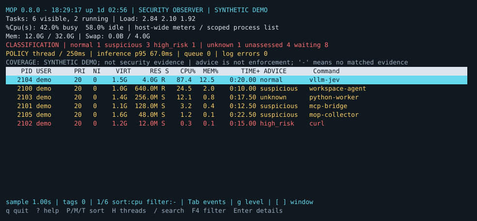
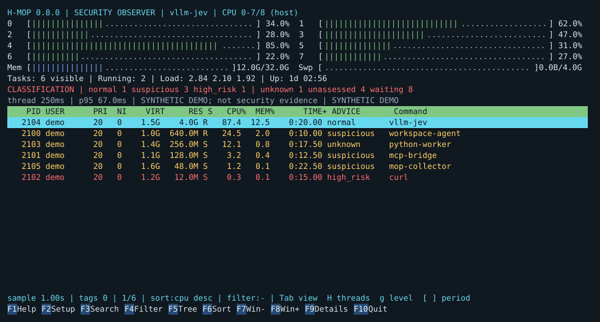
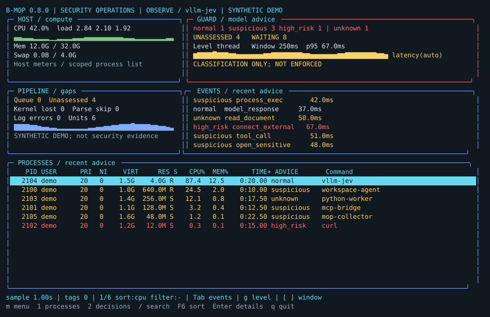

# Choose your view

All three commands show process activity and AI findings. Choose the layout you like.

## MOP — familiar and compact

```bash
mop
```

A top-style process list with resource usage and security advice.



## H-MOP — explore a process

```bash
hmop
```

CPU meters, process trees, selection and interactive inspection.



## B-MOP — watch the whole picture

```bash
bmop
```

A dashboard of resources, recent findings and review activity.



*Interface previews use sample data.*

## Keys to remember

| Key | Action |
| --- | --- |
| `P` / `M` / `T` | Sort by CPU / memory / CPU time |
| `Enter` | Inspect the selected process and evidence |
| `H` | Toggle threads |
| `K` / `R` | Signal / renice a process, with confirmation |
| `?` | Show the view's controls |
| `q` | Quit |

Use `mop -p 12345` to focus on a PID, or `mop -u "$USER"` to filter the display.

## Read the findings

- **normal** — no concrete risk signal in the reviewed evidence.
- **suspicious** — activity worth investigating.
- **high_risk** — evidence of serious misuse.
- **unknown** — the model did not return a usable classification.
- **–** — no matching retained assessment for this row.

Press **Enter** to move from a label to the evidence. Use `mop-network status` to check collection, or `mop check` to check the guard.

[Advanced controls](advanced-ui.md) · [Customize categories](classification.md)
